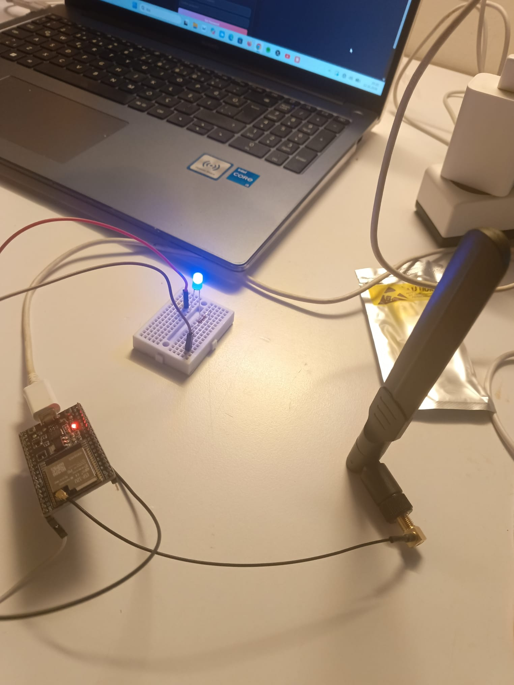

# ESP32 Wi-Fi Repeater: Donanım Kurulumu ve Sinyal Ölçümleri

Zayıf Wi-Fi sinyalini ESP32 ve harici anten ile güçlendirmek için kurduğum NAT router/repeater çalışmasının donanım, ölçüm ve deneyim notları.

> **Not:** Bu repoda firmware yoktur. Yazılım olarak açık kaynaklı [martin-ger/esp32_nat_router](https://github.com/martin-ger/esp32_nat_router) projesini kullandım; kod ona aittir, lisansı için orijinal repoya bakın. Bu repo benim donanım kurulumumu, ölçümlerimi ve yaşadığım sorunları belgeler.

## Amaç

Kaldığım ortamda Wi-Fi sinyali çalışma masamda ve yatağımda zayıftı. Amacım, sinyalin güçlü olduğu noktadan gelen ağı ESP32 ile yeniden yayınlayıp kullanım yerinde daha stabil bağlantı almaktı.

## Donanım

| Parça | Açıklama |
|---|---|
| Kart | ESP32-WROOM-32U geliştirme kartı (harici anten girişli, CP2102 USB-UART) |
| Anten | 2,4 GHz, 8 dBi, 16 cm SMA erkek anten |
| Bağlantı | 90° IPEX-SMA dişi pigtail, 15 cm |
| Durum göstergesi | Mavi LED + 330 Ω direnç] |
| Güç | USB kablo ve adaptör |

## Yazılım ve Kurulum

1. Firmware: [martin-ger/esp32_nat_router](https://github.com/martin-ger/esp32_nat_router)
2. İlk açılışta ESP32'nin kendi Wi-Fi ağına bağlanıp web arayüzünden üst ağ (uplink) ve kendi erişim noktası ayarları yapılır.
3. **Güvenlik:** Şifreler bu repoda yoktur. Kendi kurulumunda varsayılan açık erişim noktasını mutlaka şifreyle koru.

## Sinyal Ölçümleri

Aynı erişim noktasının 2,4 GHz sinyali (kanal 11), farklı noktalarda ölçüldü:

| Konum | Ölçüm | Sonuç |
|---|---|---|
| Kapı yanı | Laptop | yaklaşık -60 dBm |
| Çalışma masası | Laptop | yaklaşık -72 dBm |
| Çalışma masası | ESP32 (uplink) | yaklaşık -78 dBm |
| Yatak | Laptop / telefon analizörü | yaklaşık -86 ile -91 dBm |

Değerler konuma ve ana cihaza göre değişir, ölçümler birbirine tam denk gelmeyebilir.

## Sonuç ve Karşılaştığım Sorunlar

- Kurulum çalıştı: ESP32 üst ağa bağlandı, kendi ağını yayınladı ve birden fazla cihaz bağlandı.
- **Hız sorunu:** Farklı konumlarda denememe rağmen ESP32 üzerinden internet hızı çok yavaş kaldı. 
- Olası nedenler (henüz doğrulanmadı): ESP32'nin uplink sinyalinin masada zayıf kalması, 2,4 GHz bandın kalabalık olması, tek çekirdekli küçük donanımın sınırı.
- **Sürücü sorunu:** Kart bilgisayarda "CP2102 USB to UART Bridge" olarak göründü ama COM portu yoktu. Silicon Labs CP210x sürücüsünü kurunca çözüldü.

## Planlananlar

- Durum LED'i ve izleme paneli (web dashboard) ile bağlı cihaz sayısı ve sinyal gücünün görüntülenmesi

## Kullanılan Araçlar

ESP32, Arduino IDE , Windows `netsh wlan` komutları, telefon Wi-Fi analizörü

